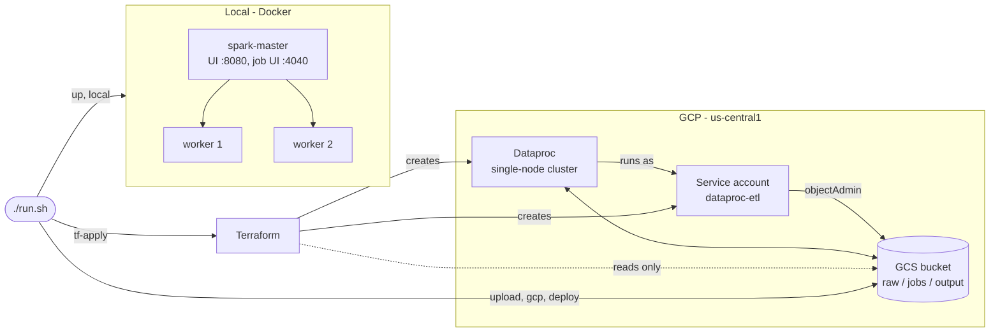
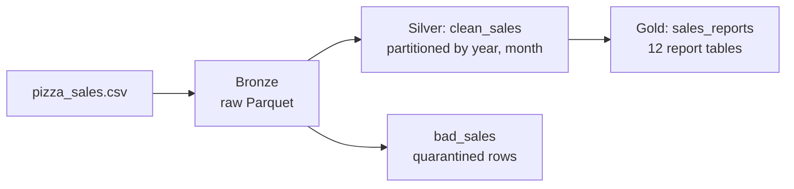

# Pizza Sales ETL: Spark on Docker + Dataproc

One PySpark script, two places to run it: a local Docker Spark cluster and a Terraform-provisioned Dataproc cluster on GCP.

## Architecture



## Data pipeline



## Project layout

```
spark-gcp-etl/
├── .env                  # project id, region, bucket, cluster name
├── run.sh                # one CLI for everything
├── Dockerfile, docker-compose.yml, spark-defaults.conf, requirements.txt
├── apps/pizza_sales_etl.py
├── data/pizza_sales.csv  # input; local output goes to data/output/
├── keys/sa.json          # optional, only for local runs against gs://
└── terraform/            # main.tf, variables.tf, outputs.tf
```

## Prerequisites

Docker, Terraform >= 1.5, `gcloud`, and a GCP project with billing enabled.

## 1. Setup (once)

```bash
chmod +x bootstrap.sh
./bootstrap.sh pizza_sales_etl.py
cd spark-gcp-etl

```

Edit `.env`:

```
PROJECT_ID=your-gcp-project-id
REGION=us-central1            # must match the bucket's location
BUCKET=your-existing-bucket   # Terraform only reads it, never creates or deletes it
CLUSTER_NAME=pizza-etl
```

Put your CSV in `data/pizza_sales.csv`.

Find your bucket's location:

```bash
source .env
gcloud storage buckets describe "gs://$BUCKET" --format="value(location)"
```

## 2. Run locally (Docker)

```bash
./run.sh up       # build image, start master + 2 workers
./run.sh local    # run ETL on data/pizza_sales.csv
```

Output: `data/output/pizza_sales/`. If in a Github Codespace, open the Ports tab for 8080 and 4040.

```bash
./run.sh logs     # follow logs(show logs)
./run.sh down     # stop
```

## 3. Provision GCP (Terraform)

```bash
gcloud auth login
gcloud auth application-default login --no-launch-browser
gcloud config set project YOUR_PROJECT_ID

./run.sh tf-init
./run.sh tf-plan      # expect: 7 to add, 0 to change, 0 to destroy
./run.sh tf-apply     # type "yes"; cluster takes about 2.5 min
```

For the login, open the printed URL and paste the code into the same waiting prompt.

If the cluster step fails with missing storage permissions, wait 2 minutes and rerun `./run.sh tf-apply`.

## 4. Run on Dataproc

```bash
./run.sh deploy       # upload CSV + script, then submit the job
```

Check the output:

```bash
source .env
gcloud storage ls "gs://$BUCKET/output/pizza_sales/"
```

Expected: `bronze/`, `clean_sales/`, `bad_sales/`, `sales_reports/`.

## 5. Clean up

```bash
./run.sh down         # stop local cluster
./run.sh tf-destroy   # remove cluster, service account, IAM bindings
```

The cluster also deletes itself after 30 idle minutes. Your bucket and data are never touched by Terraform. Dataproc's own `dataproc-staging-*` and `dataproc-temp-*` buckets are not managed by Terraform; delete them in the console if unwanted.

## Commands

| Command | What it does |
|---|---|
| `./run.sh up` / `down` / `logs` | Start, stop, follow the local cluster |
| `./run.sh local` | Run ETL on local files |
| `./run.sh local-gcs` | Run ETL from Docker on `gs://` paths (needs `keys/sa.json`) |
| `./run.sh tf-init` / `tf-plan` / `tf-apply` / `tf-destroy` | Terraform lifecycle |
| `./run.sh upload` | Copy CSV and script to the bucket |
| `./run.sh gcp` | Submit the job to Dataproc |
| `./run.sh deploy` | `upload` + `gcp` |

## Expected results

| Check | Value |
|---|---|
| `clean_sales` rows | 48,620 |
| `bad_sales` rows | 0 |
| Total revenue | 817,860.05 |
| Orders | 21,350 |
| Pizzas sold | 49,574 |

## Data notes (why the script looks the way it does)

- **Numbers like `1.00`:** IDs and quantity are stored as decimals, so they are cast to decimal first, then to integer. Spark 4 returns NULL for `try_cast('1.00' as bigint)`.
- **Mixed date formats:** `1/1/2015` style and `13-01-2015` style both occur, and both are day-first. The script tries `d/M/yyyy`, then `d-M-yyyy`.
- **Single-digit hours:** times like `9:52:21` need the `H:mm:ss` pattern.
- **Spark versions:** local Docker runs Spark 4.0 (ANSI mode on), Dataproc 2.2 runs Spark 3.5. The script gives the same results on both.

## Troubleshooting

| Symptom | Fix |
|---|---|
| `./run.sh: No such file` | `cd spark-gcp-etl` |
| Permission denied writing `data/` | `chmod -R 777 data` |
| Empty reports, or all rows in `bad_sales` | Use the fixed `pizza_sales_etl.py` (see Data notes) |
| Terraform: no default credentials | Run `gcloud auth application-default login --no-launch-browser` |
| `invalid_grant` / invalid code verifier | The code came from a different login attempt. Retry once and paste into that same prompt |
| Bucket already exists on `tf-apply` | Keep the bucket as a Terraform `data` source, not a `resource` |
| `NOT_FOUND: Cluster` on `./run.sh gcp` | Cluster was never created or idle-deleted: `./run.sh tf-apply` |
| Out of memory locally | Set `SAMPLE_FRACTION = 0.1` in `apps/pizza_sales_etl.py` |
| Changed Dockerfile or `spark-defaults.conf` | `./run.sh up` rebuilds the image |